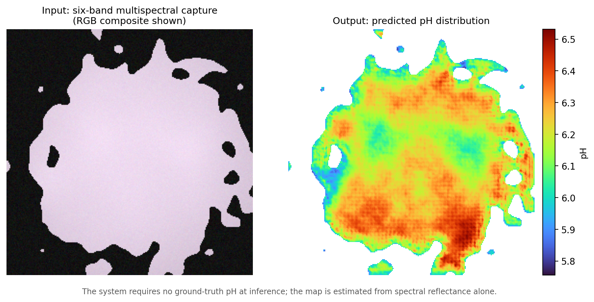
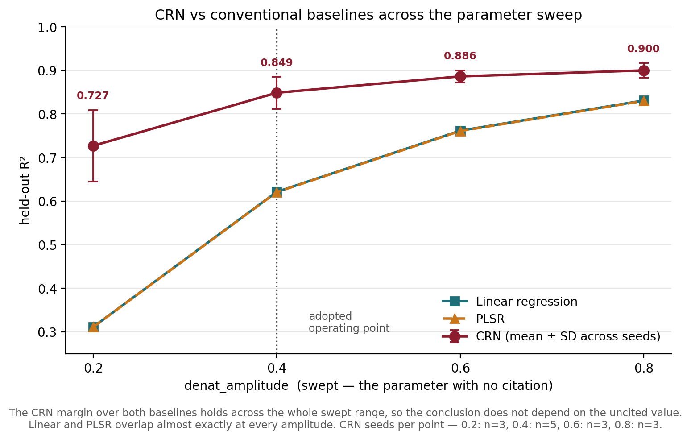

# XpHectra · LIGTAS-pH

**Pixel-wise pH mapping of pork from six-band multispectral images.**

pH is a key indicator of pork quality: low pH goes with pale, soft, exudative (PSE) meat. A pH probe, though, only measures the spot it touches. LIGTAS-pH is the software pipeline behind XpHectra. Given a six-band multispectral image (481, 525, 573, 600, 730 and 970 nm) and **just four probe readings**, a convolutional regression network (CRN) predicts pH at every pixel of the cut.

<p align="center">
  
</p>

## Results

All numbers come from a **physics-based synthetic benchmark**: 500 held-out samples the model never saw during training, and five independently seeded training runs (mean ± SD).

| Metric | CRN |
|:--|:--|
| Mean absolute error | **0.094 pH** |
| Root mean squared error | 0.128 pH |
| R² (pooled) | **0.847 ± 0.038** |
| Pixels within ±0.15 pH | 81.5% |
| Pixels within ±0.20 pH | 89.3% |

At the operating point, pixel-wise linear regression reaches R² 0.62 and partial least squares regression also reaches 0.62. One simulator parameter, the pH–scattering coupling strength, has no single citable value. The CRN's lead over both baselines holds across that parameter's full plausible range:

<p align="center">
  
</p>

Every reported number is traced to the evidence file that produced it in [`RESULTS.md`](RESULTS.md).

## How it works

1. **Simulator** ([`generate_dataset.py`](generate_dataset.py)). This is a biophysical forward model. pH drives protein denaturation and therefore light scattering, while myoglobin's redox state drives absorption independently of pH. Kubelka–Munk theory turns both into reflectance, and a sensor model adds camera noise measured from a public hyperspectral meat-imaging dataset. Each of the 14 physical parameters carries its source in code. Eleven are cited, measured, fitted or back-calculated from published data, and the remaining three are openly labeled as swept or tuned.
2. **Model** ([`crn_model.py`](crn_model.py), [`train_crn.py`](train_crn.py)). The CRN is a compact U-Net trained on only four labeled points per sample, with a total-variation smoothness prior. The dense ground-truth map is never shown during training and is used only for scoring.
3. **Evaluation**. Each script answers one question: pooled accuracy ([`evaluate_heatmap.py`](evaluate_heatmap.py)), whether high-pH regions land in the right place ([`check_spatial_localization.py`](check_spatial_localization.py)), error at tissue boundaries ([`check_edge_effect.py`](check_edge_effect.py)), and baselines across the parameter sweep ([`deconfound_full_scale.py`](deconfound_full_scale.py)).

**Why the task isn't trivial.** pH acts only on scattering, while absorption varies on its own from sample to sample. That means the same brightness can come from different pH values, so the network has to read spectral *shape* across all six bands. As a check, a linear fit on raw pixels stays near R² 0.65 on the simulator's self-test.

## Limitations

- **Synthetic data only.** Validation on real pork samples is future work. The one external comparison is 970 nm reflectance against pork in a public hyperspectral dataset: 0.26 simulated versus 0.20–0.22 measured.
- **Magnitude versus location.** The maps find the right regions: on samples that span more than one quality class, the elevated-pH region is placed correctly 99.6% of the time. However, they over-express within-sample variation by about 1.3×, which drives per-sample R² negative. This is a calibration issue, not a localization one.
- **Tissue edges.** Error more than doubles in an 8-pixel band along tissue edges (MAE 0.156 versus 0.070 pH in the interior). This is a convolutional context effect.

## Quick start

```bash
pip install -r requirements.txt          # pinned versions; see the file for the CPU-only PyTorch note
python generate_dataset.py --selftest    # physics sign check + linear non-triviality baseline
python generate_dataset.py               # frozen 400-sample training set (seed 42)
python generate_dataset.py --n 500 --seed 777 --all-test --out ligtas_test_extended
python evaluate_heatmap.py --data ligtas_test_extended --split test --out my_eval.json
python crn_demo_ui.py                    # Gradio demo at http://127.0.0.1:7860
```

The datasets (about 1.7 GB) are not committed, but they regenerate bit-for-bit from the frozen parameters. The five reported checkpoints are committed in `crn_5seed_final/`, because per-seed weights differ across machines.

## Repository guide

| Path | Contents |
|:--|:--|
| `generate_dataset.py` | Simulator and its `PARAMS` table, each value tagged with its source |
| `crn_model.py`, `train_crn.py` | Model and sparse-supervision training loop |
| `evaluate_heatmap.py`, `check_*.py` | Evaluation and audit scripts, one question each |
| `crn_5seed_final/` | The five reported checkpoints and their training logs |
| [`RESULTS.md`](RESULTS.md) | Every reportable number, with the file that produced it |
| [`docs/WALKTHROUGH.md`](docs/WALKTHROUGH.md) | Step-by-step team walkthrough: parameter sourcing, setup and each pipeline stage |
| [`docs/SYSTEM_ARCHITECTURE.md`](docs/SYSTEM_ARCHITECTURE.md) | Technical reference for the codebase |
| [`docs/TEAM_LOG.md`](docs/TEAM_LOG.md) | Dated decision log, including approaches tried and rejected |
| `manuscript/` | Thesis chapters 3–5 |

Built as a BS Computer Science thesis project at Camarines Sur Polytechnic Colleges.
